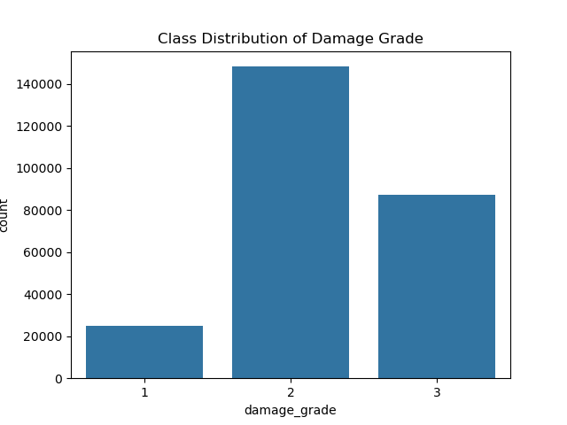
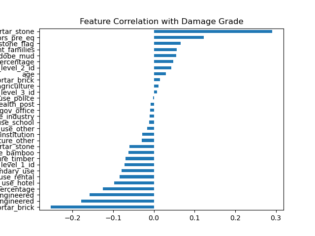

# Gorkha Earthquake Damage Prediction

This project aims to predict building damage levels caused by the 2015 Gorkha earthquake in Nepal using supervised machine learning models. 


## Overview
This project is based on the [DrivenData](https://www.drivendata.org/) competition [*Richter's Predictor: Modeling Earthquake Damage*](https://www.drivendata.org/competitions/57/nepal-earthquake/). The goal is to predict the level of earthquake damage to buildings based on their features.  
The main evaluation metric used in this competition is **micro-averaged F1 score**, with a benchmark score of **0.5815**.  

## Data  
The dataset was downloaded from [DrivenData](https://www.drivendata.org/competitions/57/nepal-earthquake/data/) and was originally collected by Kathmandu Living Labs and the Central Bureau of Statistics. It contains building information, such as structure, construction materials, and legal ownership. The target variable is an **ordinal categorical feature** with three classes indicating the level of damage (1 = low, 2 = medium, 3 = high). A detailed description of the dataset can be found in the [problem description](https://www.drivendata.org/competitions/57/nepal-earthquake/page/136/) section of the competition page.    

## Key Steps  

### Exploratory Data Analysis
A detailed analysis of the dataset was conducted, including target distribution, missing values, outliers, and correlation analysis.  
  
  

### Data Preprocessing and Feature Engineering
- Target encoding was performed on geographic ID features to avoid dimensionality explosion caused by one-hot encoding and to preserve as much geographic information as possible.
- A new feature, height/area ratio, was created to better reflect the structural form of the buildings.
- Secondary-use features were recategorised into three broader groups.
- Rare categories in the categorical features were labelled as 'other'.
- Additional preprocessing steps, such as standardisation, feature selection, one-hot encoding, and outlier elimination, were also performed.

### Modelling and Prediction
Linear SVC, Random Forest, and an ordinal regression algorithm `LogisticAT` from the *mord* library were trained and fine-tuned using Grid Search and Bayesian Optimisation.  
Based on the approach described in the paper [A Simple Approach to Ordinal Classification](https://www.researchgate.net/publication/226877154_A_Simple_Approach_to_Ordinal_Classification) and the implementation from [Ordinal Classification (tune_sklearn, skorch)](https://www.kaggle.com/code/jayahn0104/ordinal-classification-tune-sklearn-skorch#2.-Model-Selection), the standard classification model with the best performance was converted into an ordinal classifier to address the ordinal classification problem.  
A neural network model was also developed using PyTorch, incorporating embeddings for categorical features to learn feature representations and capture complex relationships between input features.  

## Results  
The fine-tuned Random Forest model with an ordinal classifier achieved the best micro-averaged F1 score of 0.7394, making an improvement of 0.1579 over the baseline. The trained Neural Network model achieved the best score of 0.7402, making an improvement of 0.1587 over the baseline.


**Feature Importance**  
Geographic location, height/area ratio, age, and foundation type of the building have the greatest influence on the model's predictions.

## Tech Stack

- **Language**: Python 3.9  
- **Environment**: Jupyter Notebook  
- **Data Processing**: Pandas, NumPy  
- **Visualisation**: Matplotlib, Seaborn  
- **Machine Learning**: Scikit-learn, Mord (for ordinal classification), Imbalanced-learn  
- **Model Tuning**: GridSearchCV, Bayesian Optimisation (optuna)  
- **Version Control**: Git, GitHub  


## Usage  
### Prerequisites
- Python 3.9 or higher
- Jupyter Notebook installed on your machine
### Setup
1. Clone the repository:
    ```
    git clone https://github.com/dawei-hu/gorkha-earthquake-damage-prediction.git
    cd gorkha-earthquake-damage-prediction
    ```
2. Install dependencies:
    ```
    pip install -r requirements.txt
    ```
3. Launch Jupyter Notebook:
    ```
    jupyter notebook
    ```
4. Open and run the notebook:  
Open the file `earthquake_damage_prediction.ipynb` and run all the cells. This notebook walks through all the major steps.

## Future work  
Future work could explore alternative methods to better address class imbalance. Advanced modelling approaches, such as stacked classifiers, could be considered to further improve performance.

## Acknowledgements  
Thanks to the paper [A Simple Approach to Ordinal Classification](https://www.researchgate.net/publication/226877154_A_Simple_Approach_to_Ordinal_Classification) and the implementation in [Ordinal Classification (tune_sklearn, skorch)](https://www.kaggle.com/code/jayahn0104/ordinal-classification-tune-sklearn-skorch#2.-Model-Selection).
